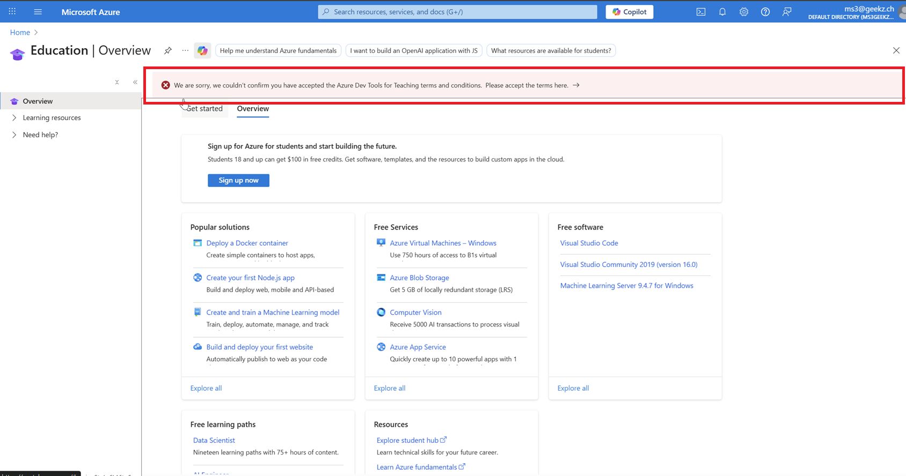

# M159 - Projekt-Setup-Sheet

In diesem Dokument werden sämtliche Angaben sowie Passwörter, welche Sie für die Installation Ihrer Umgebung benötigen, festgehalten.

---

## 1. Übersicht Umgebung

Diese Umgebung umfasst:

- **1x Windows Server (DC)** auf AWS EC2  
- **1x Windows Server (Client)** auf AWS EC2 (da AWS keine Windows Clients anbietet)  
- **1x Windows Server (Admin Center)** auf AWS EC2 zur Verwaltung der AWS Managed AD  
- **AWS Managed AD** mit Trust zur On-Premises(EC2) AD  
- **Entra Connect** zur Synchronisation mit Entra ID sowie Entra AD  
- **Lokale AD-Domain** (zu Beginn), später **öffentliche Domain als UPN**  

---

## 2. Allgemeine Angaben

| Feld                                |  Wert  |
| ----------------------------------- |  ----  |
| Vorname                             | Daryl  |
| Nachname                            | Brunner|
| Klasse                              | PE 24a |
| Dokumentation (GIT-Repository-Link) | https://github.com/Lyrad-21/m159 |

---

## 3. Ressourcen

| Feld                                                         | Wert                                            |
| ------------------------------------------------------------ | ----------------------------------------------- |
| Active Directory Second-Level-Domäne                         | tbz.brunner |
| Geplante öffentliche Domain (UPN) -> Registrieren Sie einen Namen unter https://dynv6.com/ | brunner-m159.dynv6.net |
| Azure Education Account mit 80$ ([Anleitung für Freischaltung mit neuer nicht TBZ-E-Mail](../../../02-unterrichtsressourcen/03-fachliteratur-tutorials/azure/qrc-azureforstudents.pdf)) (Wenn Sie Ihre private E-Mail-Adresse nicht verwenden möchten, können Sie beispielsweise eine Gmail-Adresse erstellen.) | brunner.daryl@gmail.com |
|                                       |                                                 |
| Azure Education Account Passwort                             | siehe Passwortmanager |

---

## 4. AWS VPC Setup

**Hinweis:**  
Alle Instanzen liegen in einem öffentlichen Subnetz und sind über RDP (Port 3389) von außen erreichbar.  
Alle weiteren Ports sind nur innerhalb des VPCs offen.  

| Komponente                      | VPC-ID                | CIDR        | Name |
| ------------------------------- | --------------------- | ----------- | ---- |
| VPC                             | vpc-0470f613e45697700 | 10.0.0.0/16 | brunner-m159-vpc |
| M159-subnet-private1-us-east-1a | siehe AWS nach Anlage | 10.0.128.0/20 | AD/DC-Subnetz |
| M159-subnet-private2-us-east-1b | siehe AWS nach Anlage | 10.0.144.0/20 | Managed-AD-Subnetz |
| M159-subnet-public1-us-east-1a  | siehe AWS nach Anlage | 10.0.0.0/20 | Client-/Admin-Center-Subnetz |
| M159-subnet-public2-us-east-1b  | siehe AWS nach Anlage | 10.0.16.0/20 | reserviert |

---

## 5. AWS Sicherheitsgruppen

### Sicherheitsgruppe für Domain Controller

| Regeltyp                     | Port(e)                 | Quelle  |
| ---------------------------- | ----------------------- | ------- |
| RDP                          | 3389  (TCP)             | 0.0.0.0 |
| LDAP                         | 389 (TCP/UDP)           | 10.0.0.0/16 |
| LDAPS                        | 636 (TCP)               | 10.0.0.0/16 |
| Kerberos                     | 88 (TCP/UDP)            | 10.0.0.0/16 |
| SMB                          | 445  (TCP)              | 10.0.0.0/16 |
| DNS                          | 53 (TCP/UDP)            | 10.0.0.0/16 |
| RPC                          | 135, 49152-65535  (TCP) | 10.0.0.0/16 |
| ICMP                         | Alle                    | 10.0.0.0/16 |
| Global Catalog               | 3268 (TCP)              | 10.0.0.0/16 |
| Global Catalog SSL           | 3269 (TCP)              | 10.0.0.0/16 |
| Kerberos Password Change/Set | 464 (TCP/UDP)           | 10.0.0.0/16 |
|                              |                         |         |

### Sicherheitsgruppe für Clients

| Regeltyp | Port(e)     | Beschreibung                             | Quelle                                           |
| -------- | ----------- | ---------------------------------------- | ------------------------------------------------ |
| RDP      | 3389        | Remote Desktop                           | 0.0.0.0                                          |
| TCP      | 88          | Kerberos Authentication                  | 10.0.0.0/20  10.0.128.0/20 10.0.144.0/20 |
| TCP      | 135         | RPC Endpoint Mapper                      | 10.0.0.0/20  10.0.128.0/20 10.0.144.0/20 |
| TCP      | 139         | NetBIOS Session Service                  | 10.0.0.0/20  10.0.128.0/20 10.0.144.0/20 |
| TCP      | 389         | LDAP                                     | 10.0.0.0/20  10.0.128.0/20 10.0.144.0/20 |
| UDP      | 53          | DNS                                      | 10.0.0.0/20  10.0.128.0/20 10.0.144.0/20 |
| TCP      | 445         | SMB/CIFS (Dateifreigabe, AD-Operationen) | 10.0.0.0/20  10.0.128.0/20 10.0.144.0/20 |
| TCP      | 49152-65535 | RPC Ephemeral Ports                      | 10.0.0.0/20  10.0.128.0/20 10.0.144.0/20 |
| ICMP     | Alle        | Ping etc.                                | 10.0.0.0/20  10.0.128.0/20 10.0.144.0/20 |

---

## 6. Active Directory Umgebung

### On-Premises Active Directory (AWS EC2)

| Feld                                  | Wert                  |
| ------------------------------------- | --------------------- |
| Active Directory Third-Level-Domäne-1 | ec2.tbz.brunner     |
| Öffentlicher UPN-Suffix (später)      | brunner-m159.dynv6.net |
| Domänenadministrator                  | Administrator         |
| Kennwort Domänenadministrator         | siehe Passwortmanager |
| Kennwort-Demote (Herunterstufen)      | siehe Passwortmanager |

### Azure AD (Entra ID)

| Feld                             | Wert |
| -------------------------------- | ---- |
| Entra ID Domain                  | wird bei Tenant-Erstellung vergeben |
| Azure Global Administrator       | brunner.daryl@gmail.com |
| Kennwort Azure Administrator     | siehe Passwortmanager |
| Entra Connect Server (DC aus AD) | dc.ec2.tbz.brunner |

### AWS Managed AD

| Feld                                  | Wert                                                 |
| ------------------------------------- | ---------------------------------------------------- |
| Active Directory Third-Level-Domäne-2 | aws.tbz.brunner                                    |
| Trust-Typ                             | Tree-Root Trust                                      |
| AWS Managed Admin User                | admin                                                |
| AWS Managed Admin Passwort            | siehe Passwortmanager                                |
| DNS-Server 1                          | wird von AWS nach Erstellung zugewiesen              |
| DNS-Server 2                          | wird von AWS nach Erstellung zugewiesen              |
| Trust Passwort                        | siehe Passwortmanager                                |
| Subnetz 1                             | M159-subnet-private1-us-east-1a (10.0.128.0/20) |
| Subnetz 2                             | M159-subnet-private2-us-east-1b (10.0.144.0/20) |

---

## 7. EC2-Instanzen

| Komponente                  | FQDN                     | Elastic IP         | Private IP (CIDR) | Subnetz                         | DNS-Server 1 | DNS-Server 2 | Lokaler Admin | Kennwort |
| --------------------------- | ------------------------ | ------------------ | ----------------- | ------------------------------- | ------------ | ------------ | ------------- | -------- |
| IaaS/OnPrem AD DC           | dc.ec2.tbz.brunner     | –                  | 10.0.129.10 | M159-subnet-private1-us-east-1a | 127.0.0.1 | siehe Managed AD | Administrator | siehe Passwortmanager |
| Windows Server (Client)     | client.ec2.tbz.brunner | nach Erstellung | 10.0.1.20 | M159-subnet-public1-us-east-1a  | 10.0.129.10 | siehe Managed AD | Administrator | siehe Passwortmanager |
| Windows Server Admin Center | adminctr.ec2.tbz.brunner | nach Erstellung | 10.0.1.30 | M159-subnet-public1-us-east-1a | 10.0.129.10 | siehe Managed AD | Administrator | siehe Passwortmanager |

---

## 8. Abteilungen & Benutzer

Definieren Sie je einen Benutzer dieser 3 Abteilungen 

| Abteilung | Name der Abteilung | Benutzername | Vorname | Nachname | Kennwort | Bereiche |
| --------- | ------------------ | ------------ | ------- | -------- | -------- | -------- |
| 1         | Sekretariat        | j.meier      | Julia   | Meier    | siehe PM | intern   |
| 2         | Buchhaltung        | t.huber      | Thomas  | Huber    | siehe PM | intern   |
| 3         | GL                 | s.notz       | Sandra  | Notz     | siehe PM | intern   |
| 4         | Promoter           | p.gomez      | Pablo   | Gomez    | siehe PM | extern   |

## 09. Python-App-Registration (Entra-ID)

| Name                    | Wert |
| ----------------------- | ---- |
| Directory (tenant) ID   | erst nach App-Registrierung in Entra ID |
| Application (client) ID | erst nach App-Registrierung in Entra ID |
| Client Secret ID        | siehe Passwortmanager |

## 10. Hinweise

- Beginnen Sie mit der lokalen Domain-Umgebung und konfigurieren Sie **später den UPN-Suffix** mit der öffentlichen Domain.  
- Achten Sie auf **richtige Portfreigaben** in den AWS Sicherheitsgruppen, insbesondere für RDP, SMB und AD-Dienste.  
- Dokumentieren Sie alle IP-Adressen, Benutzernamen und Kennwörter konsequent in dieser Vorlage.
- Diese Vorlage wurde für das Schuljahr 2025/26 komplett neu erstellt. Falls Ihnen etwas fehlt, ist die Lehrperson dankbar, wenn Sie ihr dies mitteilen.
- Alle mit "siehe Passwortmanager" markierten Felder: starkes, individuelles Passwort im Passwortmanager anlegen, nicht im Klartext hier eintragen.